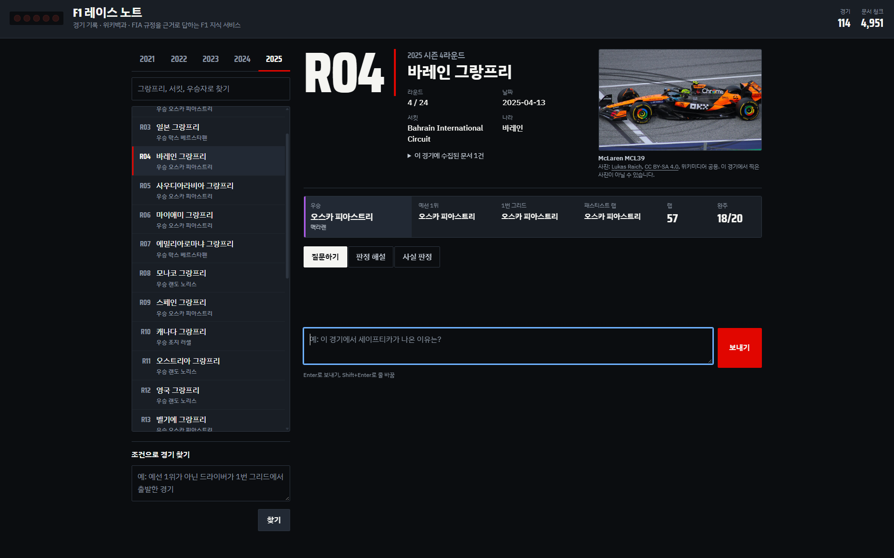
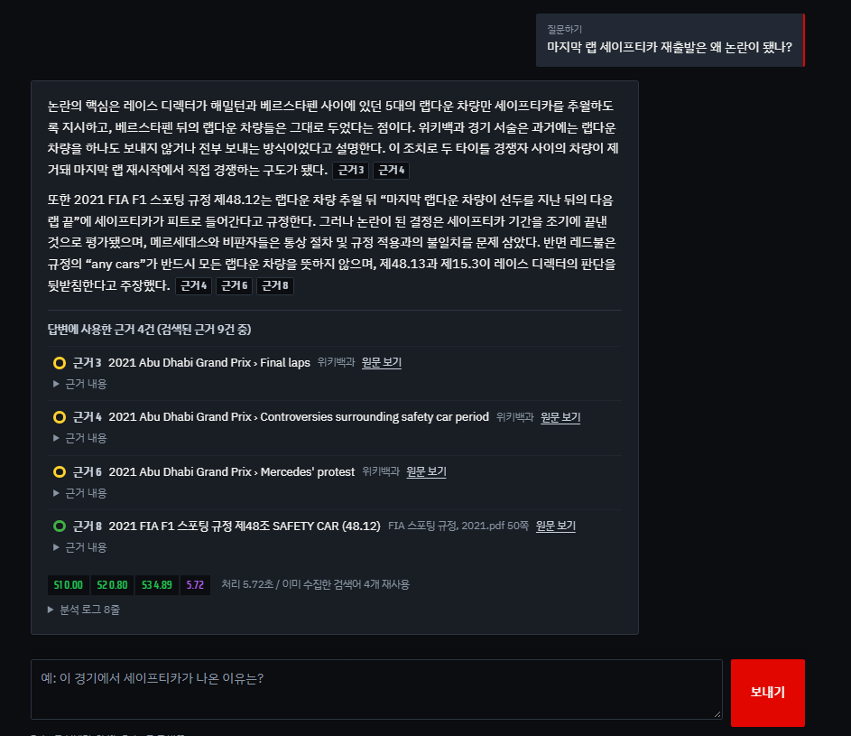
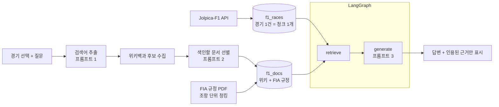

# 🏎️ F1 레이스 노트

> 경기를 고르고 질문하면 **경기 기록 · 위키백과 · 그 시즌 FIA 규정**을 근거로 답하고, **근거 원문을 함께 보여 주는** RAG 지식 서비스

F1은 규정이 해마다 바뀌고 경기 뒤 판정이 번복되는 일이 많아서, 언어 모델이 기억만으로 답하면 그럴듯하게 틀리기 쉽습니다. 이 서비스는 **"근거가 있는 것만 말하고, 없으면 모른다고 답하는"** 것을 목표로 만들었습니다. SSAFY 교육 과정 중 진행한 프로젝트입니다.



| 기간 | 기술 | 규모 |
|---|---|---|
| 2026.10 | Python · LangGraph · ChromaDB · FastAPI · Streamlit · Vanilla JS | 2021~2025 시즌 **114경기**, 문서 청크 **4,951개**, 자동 테스트 **53개** |

<br>

## 📊 핵심 결과

같은 질문 10개를 **RAG 없이(모델 기억만)** 와 **RAG로** 답하게 하고 결과를 비교했습니다. ([전체 비교](docs/04_RAG_전후_비교.md))

| 기준 | RAG 없이 | RAG 사용 |
|---|:-:|:-:|
| 사실 정확 (8문항) | 7 | **8** |
| 근거 제시 (10문항) | 0 | **10** |
| 문서에 없는 질문에 "모른다"고 답함 (2문항) | 0 — 둘 다 지어냄 | **2** |

- RAG 없이 답하면 문서에 없는 입장권 가격을 "약 2,400 AED"처럼 **지어냈지만**, RAG를 쓰면 "제공된 문서에서 확인되지 않습니다"라고 답했습니다.
- 처리 시간: 질문하기 6.2초, 판정 해설 11.3초. 같은 질문을 다시 물으면 수집 캐시 덕분에 **17.2초 → 1.8초**.

<br>

## ✨ 주요 기능

| 기능 | 설명 |
|---|---|
| **질문하기** | 경기에 관한 질문에 `[근거 n]` 번호를 붙여 답하고, 실제로 인용한 근거만 원문 링크와 함께 표시 |
| **판정 해설** | 경기 중 사건을 **그 시즌 규정 조항**과 함께 상황 · 관련 규정 · 실제 판정 · 확인 안 되는 부분으로 해설 |
| **사실 판정** | F1에 관한 주장을 사실 · 거짓 · 일부 사실 · 확인 불가로 판정 |
| **조건으로 경기 찾기** | "1번 그리드에서 출발했지만 우승하지 못한 시즌 최종전"처럼 자연어 조건으로 경기 검색 |

<p align="center"></p>
<p align="center"><sub>답변 본문의 근거 번호와 오른쪽 근거 목록이 일치하고, 위키백과와 FIA 규정은 타이어 색으로 구분돼요.</sub></p>

<br>

## 🏗 구조



- **두 컬렉션 분리**: 경기 메타데이터는 검색하지 않고 ID로 꺼내 항상 근거 1번에 넣고, 외부 문서만 의미 검색합니다.
- **경기 문서와 규정을 따로 검색**: 한 번에 검색하면 수가 많은 규정 청크가 Top-k를 차지해서, 따로 검색한 뒤 합칩니다.
- **출처별 청킹**: 위키는 섹션 경계를 지키며 1,000자 / 200자 중복, 규정은 조항 단위로 자릅니다. 길이로 자르면 조항이 중간에 끊겨 다른 조항 번호로 인용되기 때문입니다.

자세한 설계는 [RAG 파이프라인 설계문서](docs/02_RAG_파이프라인_설계문서.md)에 있습니다.

<br>

## 🔥 문제 해결 경험

실제로 돌려 보며 찾은 문제 25건을 원인과 해결까지 [설계문서 10절](docs/02_RAG_파이프라인_설계문서.md#10-겪은-문제와-해결-과정)에 기록했습니다. 그중 대표적인 것입니다.

### 1. 판정 해설에 엉뚱한 규정 조항이 근거로 잡힘
- **문제**: 2021 아부다비 세이프티카 논란을 물었는데, 세이프티카 조항 대신 피트 출발 · 대회 취소 · 프로모터 조항이 근거로 나왔습니다.
- **원인**: 한국어 질문과 영어 규정 사이의 의미 검색 점수가 거의 무작위에 가까웠고, MMR이 그중 '다양한' 조항을 골랐습니다.
- **해결**: 프롬프트 1이 영어 검색어를 함께 만들고, 한국어→영어 용어 사전으로 해당 용어가 든 조항 안에서 먼저 검색합니다. 규정 검색은 유사도 검색으로 바꿨습니다.

### 2. 응답 시간 29초 → 모델을 역할별로 분리
- **문제**: 판정 해설 한 번에 29초가 걸려 목표(30초 미만)에 아슬아슬했습니다.
- **원인**: 질문 하나에 모델을 3번 부르는데, 그중 2번(검색어 추출 · 후보 선별)은 짧은 JSON만 내는데도 모두 가장 비싼 모델을 썼습니다.
- **해결**: JSON 단계는 초경량 모델(호출당 1크레딧), 품질이 중요한 답변 생성 · 채점만 고성능 모델(25크레딧)로 나눴습니다. 기존에는 세 호출 모두 40크레딧 모델이었습니다.

### 3. MMR로 바꿨는데 결과가 하나도 달라지지 않음
- **문제**: 유사도 검색과 MMR을 비교했더니 두 경기 모두 근거 목록이 완전히 같았습니다.
- **원인**: '영어 용어가 든 문단을 먼저 찾는 단계'가 항상 유사도 검색이었고, 그 단계만으로 Top-k가 채워져 검색 방식 설정이 결과에 닿지 않았습니다.
- **해결**: 그 단계도 설정을 따르게 고쳤습니다. 다시 비교하니 서로 다른 문서 수 2 → 3, 근거 간 평균 유사도 0.629 → 0.520으로 근거가 다양해졌습니다. 다만 관련 섹션이 빠지는 대가가 있어 λ를 0.5 → 0.7로 조정했습니다. ([비교 결과](docs/results/retrieval_comparison.md))

### 4. 근거를 달았는데 "근거 없음"으로 집계됨
- **문제**: RAG 전후 비교에서 근거 제시가 8/10으로 나왔는데, 실제 답변을 읽어 보니 근거를 달고 있었습니다.
- **원인**: 모델이 `[위키백과 근거 4]`처럼 대괄호 안에 출처 이름을 섞어 썼고, 해석 규칙은 `[근거 n]`만 인식했습니다.
- **해결**: 프롬프트에 표기 규칙을 넣고, 해석 규칙은 변형 표기도 읽도록 완화했습니다. 저장된 답변으로 다시 채점해 10/10을 확인했습니다. **숫자를 그대로 믿지 않고 원문을 직접 읽어 확인**한 덕분에 찾은 문제입니다.

<br>

## ✅ 검증

- **자동 테스트 53개**: 가짜 모델로 API 키 없이 실행됩니다. ID 충돌, 캐시, 경기 간 근거 섞임, 근거 번호 표시, 오류 정보 비노출, 소스 속 API 키 검사 등을 확인합니다.
- **실제 실행 검증**: 실제 모델과 데이터로 `verify.py`, `compare_retrieval.py`, `evaluate_rag.py`를 돌리고 화면 19장을 캡처했습니다. → [검증 결과](docs/03_검증_결과.md)
- **안전 장치**: API 키는 `.env`로만 받고, 화면에는 오류 번호만 보여 주고 상세는 로그에만 남깁니다. 외부 API는 호출 간격 · 재시도 규칙을 지키고, 재배포 허락을 확인하지 못한 FIA PDF는 저장소에 올리지 않았습니다.

<br>

---

## 실행 방법

Python 3.10 이상이 필요합니다.

```bash
# 1. 설치
python -m venv .venv
source .venv/bin/activate            # Windows: .venv\Scripts\activate
pip install -r requirements.txt

# 2. 키 설정: .env.example 을 .env 로 복사한 뒤 OPENAI_API_KEY(또는 GMS_KEY), WIKI_CONTACT(이메일)를 입력
cp .env.example .env                 # Windows: copy .env.example .env
python scripts/check_llm.py          # 키·주소·모델 연결 점검 (색인 전에 한 번)

# 3. 데이터 준비와 색인 (처음 한 번)
python scripts/build_races.py        # Jolpica → data/processed/races.json, 위키 문서 커버리지 표
python scripts/index_items.py        # 경기 메타데이터 색인 (RAG 1)
python scripts/download_pdfs.py      # FIA 스포팅 규정 PDF 내려받기
python scripts/index_pdfs.py         # 규정 PDF 조항 단위 색인
python scripts/collect_item_docs.py  # (선택) 경기별 위키 문서 미리 수집. 첫 질문이 빨라짐

# 4-a. Streamlit 화면
streamlit run app.py                 # http://localhost:8501

# 4-b. HTML/CSS/JS 화면
uvicorn f1rag.api.server:app --port 8000   # http://localhost:8000, API 문서 /api/docs
```

기본 설정은 SSAFY GMS 모델을 Responses API(`/v1/responses`)로 호출합니다. 답변 생성과 평가 채점은 `gpt-5.6-terra`, 검색어 추출·후보 선별·조건 탐색은 초경량 `gpt-6-luna`를 씁니다. `.env.example`에 GMS 주소가 들어 있습니다. OpenAI를 직접 쓰면 `OPENAI_BASE_URL` 줄을 비우고 `config/settings.yaml`의 `models`에서 모델 이름을 바꿉니다. GPT-5 계열은 `temperature`를 받지 않아 `null`로 두었고, 응답 시간을 줄이려고 `reasoning_effort: low`를 씁니다. 짧은 JSON만 내는 단계에 플래그십 모델을 쓰면 비용과 시간만 늘어서 모델을 둘로 나눴습니다. 답변 품질을 더 높이려면 `chat`을 `gpt-5.6-sol`로 바꿉니다.

외부 호출이 막힌 환경이라면, 온라인 환경에서 `python scripts/collect_item_docs.py --export-offline`로 문서 묶음을 만든 뒤 `settings.yaml`에서 `collection.offline: true`로 바꿔 실행합니다.

### 검증과 평가

```bash
python -m pip install -r requirements-dev.txt
python -m pytest -v                  # 자동 테스트 53개 (가짜 모델, 키 없이 실행)
python scripts/verify.py             # 실제 실행 검증 → docs/results/verification_report.md
python scripts/compare_retrieval.py  # 유사도 vs MMR, Top-k 비교 → docs/results/retrieval_comparison.md
python scripts/evaluate_rag.py       # RAG 전후 비교 → docs/04_RAG_전후_비교.md
```

API 키 없이 화면만 확인하려면 `F1RAG_FAKE_MODELS=1`로 실행합니다. 이때 답변은 형식만 맞춘 예시이고, 화면 상단에 가짜 모델 모드라고 표시됩니다. 색인과 캐시도 실제 모드와 다른 폴더(`data/chroma_fake`, `data/cache_fake`)를 씁니다.

## 데이터 준비와 색인 절차

1. `build_races.py`가 Jolpica-F1 API에서 시즌별 일정과 결선 결과를 받아 경기마다 우승·포디움·1번 그리드·리타이어 수를 정리합니다. 경기마다 위키백과 '경기 자체 문서'를 정합니다. 기본 설정은 영어 원문만 씁니다(아래 '영어 원문을 쓰는 이유').
2. `index_items.py`가 경기 1건을 검색 텍스트 하나로 만들어 경기 ID를 청크 ID로 색인합니다. 다시 실행해도 덮어쓰기만 일어납니다.
3. `index_pdfs.py`가 FIA 스포팅 규정을 조항(`55) SAFETY CAR`) 단위로 자르고, 쪽마다 반복되는 머리말·꼬리말을 지운 뒤 시즌 정보와 함께 색인합니다.
4. 질문할 때 위키 문서를 수집합니다. 같은 경기에서 이미 수집한 검색어는 다시 수집하지 않습니다.

## 영어 원문을 쓰는 이유

질문과 답변은 한국어지만, 근거 문서는 영어 원문(영어 위키백과, FIA 규정)만 씁니다. 질문하면 프롬프트 1이 영어 검색 문장을 함께 만들고, 그 문장으로 영어 원문을 검색한 뒤 한국어로 답합니다.

- 한국어 경기 문서는 결과표만 있거나 영어판을 줄여 옮긴 경우가 많아, 세이프티카·페널티 같은 경기 중 사건이 빠져 있습니다.
- 두 언어 문서를 섞으면 같은 사람이 "베르스타펜"과 "페르스타펀"으로 섞여 나오고, 같은 사건의 서술이 엇갈립니다.
- 한국어 질문으로 영어 문서를 그대로 검색하면 점수가 낮게 나와, 관련 문단이 근거에서 밀립니다.

한국어 문서도 쓰고 싶다면 `config/settings.yaml`의 `collection.languages`를 `[ko, en]`으로 바꾸면 한국어 문서도 함께 씁니다.

## 데이터·문서 출처와 이용 조건

| 데이터 | 출처 | 이용 조건 |
| --- | --- | --- |
| 경기 메타데이터 | [Jolpica-F1 API](https://github.com/jolpica/jolpica-f1) | 비상업적 이용, CC BY-NC-SA 4.0, 초당 4회·시간당 500회 |
| 경기·개념 문서 | 영어 위키백과 (설정으로 한국어 추가 가능) | CC BY-SA 4.0, 연락처가 들어간 User-Agent 필요 |
| 스포팅 규정, 심판 결정문 | [FIA](https://www.fia.com/regulation/category/110) | 재배포 허락을 확인하지 못해 PDF는 저장소에 넣지 않고 링크와 내려받기 스크립트만 둠 |

자세한 내용은 [docs/05_데이터_출처와_이용조건.md](docs/05_데이터_출처와_이용조건.md)에 있습니다. 이 서비스는 FIA · Formula 1과 관련이 없는 학습용 프로젝트입니다.

## 기능별 구현 메모

- **HTML 화면**: 화면(`web/`)과 서버(`f1rag/api/`)를 분리했습니다. 요청·응답 형식은 `f1rag/api/schemas.py`에 정의했고, `/api/ask`는 진행 상태를 한 줄씩 보내는 NDJSON 스트림입니다. 근거 종류는 F1 타이어 컴파운드 색으로 구분하고, 답변 진행은 랩의 세 섹터(S1 문서 수집, S2 근거 검색, S3 답변 생성)로 보여 줍니다. 근거 번호를 누르면 원문 패널이 열립니다. 경기를 고르면 우승 팀의 그 시즌 차 사진(위키미디어 공용 자유 라이선스, 출처 표시)이 함께 나옵니다. 사진을 미리 받아 확인하려면 `python scripts/check_car_images.py`. 첫 진입 연출을 캡처하려면 `http://localhost:8000/?intro=hold`(라이트 다섯 칸이 켜진 채 멈춤) 또는 `?intro=title`(꺼진 뒤 서비스 이름에서 멈춤)으로 열고, 화면을 누르면 넘어갑니다.
- **MMR 검색**: `settings.yaml`의 `retrieval.search_type: mmr`이 기본값입니다. `compare_retrieval.py`가 같은 질문의 유사도 검색과 MMR 결과를 비교합니다. 비교 지표는 서로 다른 문서 수, 근거 간 평균 유사도, 출처 종류 분포입니다.
- **RAG 전후 비교**: `eval/questions.yaml`에 질문 10개와 참고 답안이 있습니다. 문서에 없는 내용을 묻는 질문 2개가 포함됩니다.
- **여러 출처 결합**: 위키는 섹션 경계를 지키며 1,000자/200자로 자르고, 규정은 조항 단위로 자릅니다. 길이로 자르면 조항이 중간에 끊겨 다른 조항 번호로 인용되기 때문입니다.

## 폴더 구조

```text
app.py                     Streamlit 진입점
config/settings.yaml       청크 크기, Top-k, 검색 방식 등 실행 설정
f1rag/
  domain/                  데이터 준비 영역: F1에 묶인 코드와 문구
    races.py               Jolpica → 경기 메타데이터, 색인 텍스트
    regulations.py         FIA 규정·결정문 PDF 파싱과 청킹
    names.py               한국어 표기
    profile.py             역할 문구, 출처 이름, 기능별 답변 형식, 검색 범위 규칙
  sources/                 외부 문서 출처: HTTP 예절, 위키백과, 오프라인 묶음, PDF
  store/                   Vector Store 영역: 컬렉션, 위키 청킹, 청크 ID
  rag/                     RAG 파이프라인 영역: 프롬프트, 수집기, 캐시, 검색·병합, LangGraph, 근거 번호
  services/                서비스 기능 영역: 질의응답·판정, 조건 탐색
  ui/                      Streamlit 화면
  api/                     FastAPI 서버와 요청·응답 형식
  devtools/                가짜 모델, 키 검사
web/                       HTML/CSS/JS 화면
scripts/                   수집·색인·검증·평가 스크립트
eval/questions.yaml        RAG 전후 비교 질문
tests/                     자동 테스트 (가짜 모델)
docs/                      기능 정의, 설계문서, 검증 결과, 비교 결과, 출처
```

## 문서

- [기능 정의](docs/01_기능_정의.md)
- [RAG 파이프라인 설계문서](docs/02_RAG_파이프라인_설계문서.md)
- [검증 결과](docs/03_검증_결과.md)
- [RAG 전후 비교](docs/04_RAG_전후_비교.md)
- [데이터 출처와 이용 조건](docs/05_데이터_출처와_이용조건.md)

> 로컬에서 개발한 뒤 이 저장소로 옮겨 올려서 커밋 기록이 짧습니다.
