# 검증 결과

검증은 두 단계로 한다.

1. **자동 테스트(가짜 모델)**: `pytest`로 실제 OpenAI·위키백과 없이 파이프라인 규칙(ID, 캐시, 필터, 근거 표시, 오류 비노출)을 확인한다. 53개 모두 통과했다 (`docs/results/pytest_results.txt`).
2. **실제 실행**: API 키와 실제 데이터로 `scripts/verify.py`, `scripts/compare_retrieval.py`, `scripts/evaluate_rag.py`를 실행하고, 화면을 캡처한다. 결과는 `docs/results/`와 이 문서의 "실제 실행" 열에 기록한다.

상태 표기: **통과** / **실패** / **미확인**(아직 실행·캡처하지 않음).

## 1. 요구사항 대조표

| 번호 | 요구사항 | 구현 위치 | 자동 테스트 (가짜 모델) | 실제 실행 확인 방법 | 실제 실행 |
| --- | --- | --- | --- | --- | --- |
| F2001 | 항목 메타데이터 적재 | `domain/races.py` | 통과: `test_summarize_race_fields`, `test_item_text_has_all_search_attributes` | `build_races.py` 출력의 경기 수, `index_items.py --show` | 통과: 경기 114건, 색인 텍스트에 시즌·라운드·서킷·포디움·예선 1위·1번 그리드·미완주 수 포함 |
| F2002 | 메타데이터 색인 | `store/vectorstore.py`, `scripts/index_items.py` | 통과: `test_index_twice_does_not_duplicate` | verify.py 4.1, 화면 색인 건수 캡처 | 통과: 청크 114개, 다시 색인해도 114개 |
| F2003 | 검색어 추출 | `rag/prompts.py`, `rag/collector.py` | 통과: `test_ask_collects_item_doc_and_cites` | verify.py 4.2 검색어 목록 | 통과: 세이프티카, 마이클 마시, 2021년 포뮬러 원 시즌, Formula One regulations |
| F2004 | 외부 문서 수집 | `rag/collector.py`, `sources/` | 통과: `test_selection_rejects_are_reported`, `test_item_doc_found_by_search_when_not_predefined`, `test_same_question_does_not_collect_again` | verify.py 4.2 후보 선별 결과 | 통과: 처음 묻는 질문으로 후보 10건 중 1건 색인(Lewis Hamilton), 9건 제외(동명이인·무관 문서), 경기 자체 문서(영어) 색인 |
| F2005 | 외부 문서 색인 | `store/chunking.py` | 통과: `test_chunk_ids_do_not_collide_across_items`, `test_chunk_size_setting_changes_chunk_count`, `test_split_sections` | verify.py 4.2 청크 수 비교 | 통과: 500/100자 3개, 1000/200자 2개, 2000/300자 2개 |
| F2006 | 근거 검색 및 병합 | `rag/retriever.py` | 통과: `test_top_k_changes_evidence`, `test_retrieval_stays_inside_selected_race`, `test_merge_removes_duplicates` | verify.py 4.3 Top-k | 통과: k=3 → 근거 6개, k=6 → 9개, k=10 → 13개 |
| F2007 | 근거 기반 답변 생성 | `rag/graph.py` | 통과: `test_graph_has_two_nodes` | verify.py 4.3 그래프·모름 응답 | 통과: retrieve → generate, 문서에 없는 질문(입장권 가격)에 확인되지 않는다고 답함 |
| F2008 | 근거 표시 | `rag/citations.py` | 통과: `test_citation_parsing`, `test_no_citation_shows_notice` | 답변 화면 캡처 | 통과: 본문 번호 [2,3,4,5,6,8] = 표시 목록. 화면 캡처 필요 |
| F2009 | 항목 선택 및 질의응답 | `ui/streamlit_app.py`, `web/` | 통과: `test_status_and_races` | 경기 바꾸기 화면 캡처 | 통과: 2021 아부다비에서 대화한 뒤 2023 사우디로 바꾸면 대화가 비어 있음 (`04_switch_race_a/b.png`) |
| F2010 | 도메인 특화 기능 | `domain/profile.py`, `services/qa.py` | 통과: `test_ruling_mode_adds_notice` | 판정 해설·사실 판정 캡처 | 통과: 판정 해설 근거 9건 중 규정 3건(2021 제48.12조 등) |
| F2011 | 조건 기반 항목 탐색 | `services/explore.py` | 통과: `test_explore_returns_only_candidates`, `test_explore_year_filter`, `test_explore_api` | 조건 탐색 캡처, 결과를 사람이 확인 | 통과: '예선 1위가 아닌 드라이버가 1번 그리드' 4건 모두 조건에 맞음(사람 확인). 최종전 조건 0건은 확인한 최종전 5경기 모두 1번 그리드 출발 드라이버가 우승해 맞는 결과. 누락 경기를 찾아 후보 규칙 추가(4절) |
| F2012 | 진행 상태 및 안내 | `services/qa.py`, 두 화면 | 통과: `test_ask_streams_progress_then_result`, `test_status_without_api_key`, `test_empty_index_message`, `test_unknown_item_message`, `test_failed_search_is_retried_next_time`, `test_missing_wiki_contact_is_reported` | 진행 상태·색인 없음·키 없음 캡처 | 통과: 라이브 분석 진행 상태(`02_progress.png`), 색인 없음(`08_no_index.png`)·API 키 없음(`09_no_key.png`) 안내에 실행할 일이 적힘 |
| F2013 | 프론트엔드 직접 구현 | `api/`, `web/` | 통과: `test_ask_streams_progress_then_result`, `test_ask_validation`, `test_explore_api` | HTML 화면 캡처 | 통과: HTML 화면에서 질문·답변·근거 목록, 근거 번호를 누르면 원문 패널 (`11_html_ui.png`, `11_html_drawer.png`) |
| F2014 | MMR 검색 | `rag/retriever.py` | 통과: `test_top_k_changes_evidence`(mmr 경로) | `compare_retrieval.py` 결과 | 통과: λ0.5 비교에서 두 질문 모두 같은 섹션 중복이 사라지고 근거가 4개·3개 바뀜, 아부다비 질문은 서로 다른 문서 2→3, 근거 간 평균 유사도 0.629→0.520. 관련 섹션이 빠지는 대가가 있어 기본값을 λ0.7로 조정 (4절) |
| F2015 | RAG 전후 비교 | `scripts/evaluate_rag.py` | 해당 없음 (실제 모델 필요) | `docs/04_RAG_전후_비교.md` | 통과: 정확도 RAG 8/8 vs 없이 7/8, 근거 제시 10/10 vs 0, 모름 응답 2/2 vs 0/2 (15:00 실행, 4절) |
| F2016 | 여러 문서 출처 결합 | `domain/regulations.py`, `sources/pdf.py` | 통과: `test_regulation_pdf_articles`, `test_regulation_chunks_split_long_article_at_sub_articles` | `index_pdfs.py --show 2021 48`, 근거 목록 캡처 | 통과: 메타데이터·위키백과·FIA 스포팅 규정이 출처별로 구분되어 근거에 함께 나옴 |
| NF2001 | 응답 시간 | `services/qa.py` 처리 시간 | 해당 없음 | verify.py 4.7 (30초 미만) | 부분 통과: 질문하기 6.2초, 판정 해설 11.3초, 문서에 없는 질문 4.2초. 판정 해설은 GMS 응답 편차로 31.3초·51.8초까지 걸린 적이 있음(4절) |
| NF2002 | 수집 캐시 | `rag/cache.py` | 통과: `test_same_question_does_not_collect_again` | verify.py 4.2 | 통과: 재질문 시 새 색인 0건 |
| NF2003 | API 키 관리 | `.env`, `.gitignore`, `devtools/secret_scan.py` | 통과: `test_no_api_keys_in_source` | 제출 zip에 `.env` 없음 확인 | 통과: 소스 검사 검출 없음. 제출 zip `.env` 제외 확인 필요 |
| NF2004 | 내부 정보 비노출 | `api/server.py`, `ui/streamlit_app.py` | 통과: `test_unexpected_error_is_masked` | 오류 화면 캡처 | 통과: 키 없음·색인 없음 화면에 안내 문구만 보이고 키·경로·추적 정보가 없음 (`08`, `09`). 실제로 난 오류(아래 WinError 5)도 화면에는 오류 번호만, 추적 정보는 `logs/app.log`에만 남음([fea5418d]) |
| NF2005 | 모듈 분리 | 폴더 구조 | 해당 없음 | README 폴더 구조 | 통과 (구조로 확인) |
| NF2006 | 외부 API 예절 | `sources/http.py` | 통과: `test_polite_session_retries_and_user_agent` | `logs/app.log` 재시도 기록 | 미확인: `logs/app.log`에서 재시도 기록 확인 (실행 중 위키 오류가 없으면 기록이 없을 수 있음) |
| NF2007 | 출처와 이용 조건 | `docs/05_데이터_출처와_이용조건.md` | 해당 없음 | 문서 확인 | 통과 (문서로 확인) |

## 2. 테스트 결과표 (자동 테스트, 가짜 모델)

실행 환경: Python 3.13, 명세서 1.2-5)의 고정 버전 라이브러리. 실행: `python -m pytest -v`

| 테스트 | 확인 내용 | 관련 요구사항 | 결과 |
| --- | --- | --- | --- |
| test_summarize_race_fields | 우승자·폴 투 윈·최종전·스프린트·리타이어 수 정리, 예선 1위와 1번 그리드 출발을 따로 기록하고 다를 때 그 사실을 색인 텍스트에 넣음 | F2001, F2011 | 통과 |
| test_item_text_has_all_search_attributes | 색인 텍스트에 검색 속성이 모두 있음 | F2001, 4.1 | 통과 |
| test_item_metadata_has_no_none | 메타데이터에 None 없음 | F2002 | 통과 |
| test_index_twice_does_not_duplicate | 두 번 색인해도 청크 수 유지 | F2002, 4.1 | 통과 |
| test_regulation_pdf_articles | 조항 인식(악센트 문자 제목 포함), 제목을 놓친 조항을 하위 조항 번호로 분리, 목차·본문 목록 제외, 머리말·꼬리말 제거, 하위 조항 누락 없음 | F2016 | 통과 |
| test_regulation_chunks_split_long_article_at_sub_articles | 긴 조항은 하위 조항 경계에서 분할, ID 중복 없음, 쪽 링크 | F2016 | 통과 |
| test_ask_collects_item_doc_and_cites | 경기 자체 문서 색인, 메타데이터가 근거 1번, 인용 근거만 표시, 단계별 시간 | F2003, F2004, F2006, F2008 | 통과 |
| test_same_question_does_not_collect_again | 같은 질문은 검색어 캐시를 쓰고 새로 수집하지 않음 | F2004, NF2002, 4.2 | 통과 |
| test_item_doc_found_by_search_when_not_predefined | 자체 문서가 정해지지 않은 경기는 검색으로 찾고, 한국어가 없으면 영어 문서 | F2004 | 통과 |
| test_selection_rejects_are_reported | 선별·제외 문서와 제외 이유가 구분됨 | F2004, 4.2 | 통과 |
| test_chunk_ids_do_not_collide_across_items | 두 경기가 같은 문서를 수집해도 ID가 겹치지 않음 | F2005 | 통과 |
| test_chunk_size_setting_changes_chunk_count | 청크 크기 설정을 바꾸면 청크 수가 달라짐, 각주 섹션 제외 | F2005, 4.2 | 통과 |
| test_split_sections | 위키 섹션 분할 | F2005 | 통과 |
| test_top_k_changes_evidence | Top-k에 따라 근거 수가 바뀜, MMR 경로 동작 | F2006, F2014, 4.3 | 통과 |
| test_retrieval_stays_inside_selected_race | 다른 경기 문서가 근거에 섞이지 않음 | F2006 | 통과 |
| test_merge_removes_duplicates | ID·본문이 같은 청크 제거 | F2006 | 통과 |
| test_graph_has_two_nodes | LangGraph 노드가 retrieve·generate 두 개 | F2007, 4.3 | 통과 |
| test_citation_parsing | `[근거 1, 3]`, `[근거 4-5]` 등 표기 해석, 실제 실행에서 나온 변형 표기(`[위키백과 근거 4]`, `[경기 메타데이터·근거 1]`) 해석, 없는 번호 분리 | F2008 | 통과 |
| test_no_citation_shows_notice | 인용 근거가 없으면 안내 | F2008, 4.3 | 통과 |
| test_ruling_mode_adds_notice | 판정 해설에 공식 판정 아님 안내 | F2010, F2012 | 통과 |
| test_parse_json_variants | 코드블록·설명이 붙은 JSON 읽기 | F2003, F2004 | 통과 |
| test_item_text_used_in_query_prompt | 한국어 드라이버 표기가 텍스트에 들어감 | F2001 | 통과 |
| test_status_and_races | 상태·경기 목록 API | F2009, F2013 | 통과 |
| test_ask_streams_progress_then_result | 진행 상태 줄 → 결과 줄, 내부 정보 미포함 | F2012, F2013, NF2004 | 통과 |
| test_ask_validation | 빈 질문·잘못된 기능 거부 | F2013 | 통과 |
| test_unexpected_error_is_masked | 예상 못 한 오류는 오류 번호만 보내고 키·추적 정보 숨김 | NF2004 | 통과 |
| test_unknown_item_message | 없는 경기 안내 | F2012 | 통과 |
| test_status_without_api_key | 키가 없으면 안내 문구 | F2012, NF2003 | 통과 |
| test_empty_index_message | 색인 0건 안내에 실행할 스크립트 표시 | F2012 | 통과 |
| test_explore_returns_only_candidates | 후보에 없는 경기 ID(지어낸 결과)는 버림 | F2011 | 통과 |
| test_explore_year_filter | 조건의 연도로 시즌 필터 | F2011 | 통과 |
| test_explore_api | 조건 탐색 API | F2011, F2013 | 통과 |
| test_polite_session_retries_and_user_agent | 연결 오류·429 재시도, User-Agent 연락처 | NF2006 | 통과 |
| test_no_api_keys_in_source | 소스에 키 형식 문자열 없음 | NF2003 | 통과 |
| test_failed_search_is_retried_next_time | 위키 검색이 일시 실패하면 안내하고, 실패한 검색어는 캐시에 남기지 않아 다음 질문 때 다시 수집 | F2012, NF2002, NF2006 | 통과 |
| test_regulations_do_not_crowd_out_race_docs | 규정 청크가 많아도 경기 문서가 Top-k만큼 들어오고 규정은 기능별 개수만 더해짐 | F2006 | 통과 |
| test_korean_question_finds_english_safety_car_article | 한국어 질문(세이프티카)으로 영어 규정의 SAFETY CAR 조항을 찾음, 용어가 없는 질문은 일반 검색 | F2006, F2016 | 통과 |
| test_prompt1_regulation_query_is_cached_and_old_cache_still_works | 프롬프트 1의 영어 규정 검색어가 쓰이고 캐시되며, 이전 형식 캐시도 동작 | F2003, NF2002 | 통과 |
| test_english_only_mode_uses_english_sources | 영어 원문 모드에서 항목 자체 문서·근거가 영어 문서만이고, 한국어 질문으로 영어 원문의 해당 문단(safety car)을 찾음 | F2004, F2006 | 통과 |
| test_english_race_article_is_always_a_target | 한국어 경기 문서가 있어도 영어 경기 문서를 함께 수집 | F2004 | 통과 |
| test_fast_model_is_separate_when_configured | 답변·채점 모델(chat)과 검색어 추출·선별·탐색 모델(chat_fast)이 설정대로 따로 만들어짐 | NF2001 | 통과 |
| test_gms_model_settings_build_responses_request | GMS 주소·GMS_KEY·Responses API·추론 강도 설정이 요청에 반영되고 temperature는 빠짐 | NF2003 | 통과 |
| test_missing_wiki_contact_is_reported | 위키 연락처가 없으면 수집 단계가 오류를 삼키지 않고 안내 문구로 알림 | F2012, NF2006 | 통과 |
| test_mmr_setting_applies_to_english_term_search | 영어 용어가 든 문단을 먼저 찾는 단계도 search_type을 따름(MMR이면 MMR, 유사도면 유사도) | F2014 | 통과 |
| test_explore_always_checks_season_finales | '최종전' 조건이면 각 시즌 마지막 라운드가 후보에 반드시 들어가고, 확인한 경기의 예선 1위·1번 그리드·우승이 결과에 포함 | F2011 | 통과 |
| test_explore_checks_every_race_where_pole_differs_from_grid_one | '예선 1위가 아닌 … 1번 그리드' 조건이면 두 값이 다른 경기를 모두 후보에 넣음 | F2011 | 통과 |
| test_same_search_sentence_is_embedded_once | 같은 검색 문장은 임베딩을 한 번만 요청 | NF2001, NF2006 | 통과 |
| test_car_photo_is_season_car_with_free_license_and_cached | 우승 차 사진은 시즌 문서가 아닌 그 시즌 차 문서의 자유 라이선스 사진, 작성자·라이선스 기록, 결과 캐시, 네트워크 오류는 캐시 안 함 | F2013, NF2006, NF2007 | 통과 |
| test_car_endpoint_without_finder_is_quiet | 사진 찾기를 쓸 수 없으면 오류 없이 found=false | F2013, NF2004 | 통과 |
| test_car_photo_uses_variant_name_and_variant_photo | 개량형(MCL35M)이 기본형 문서로 넘겨주기만 돼 있어도 개량형 이름을 쓰고, 파일 이름에 개량형이 들어간 사진을 고름 | F2013 | 통과 |
| test_long_official_name_is_not_a_variant | 같은 차의 긴 공식 이름(Mercedes-AMG F1 W12 E Performance)은 개량형으로 보지 않음 | F2013 | 통과 |
| test_cache_save_survives_windows_file_lock | 윈도우에서 캐시 파일이 잠겨 바꾸기가 거부되면(WinError 5) 다시 시도하고, 끝내 실패해도 예외 없이 답변 계속, 임시 파일 안 남김 | NF2002, NF2004 | 통과 |
| test_two_servers_do_not_erase_each_others_cache | Streamlit과 FastAPI 서버가 같은 캐시 파일을 써도 서로의 항목을 지우지 않음 | NF2002 | 통과 |

## 3. 셀프 체크리스트 (명세서 4장)

"자동"은 가짜 모델 테스트 결과다. "실제"는 API 키로 실행한 뒤 채운다.

| 절 | 확인 항목 | 자동 | 실제 | 증명 자료 |
| --- | --- | --- | --- | --- |
| 4.1 | 로드한 항목 수와 색인 청크 수 일치 | 통과 | 통과 | verify.py |
| 4.1 | 색인을 두 번 실행해도 청크 수 유지 | 통과 | 통과 | verify.py |
| 4.1 | 항목 1건 색인 텍스트에 속성이 모두 있음 | 통과 | 통과 | `index_items.py --show` |
| 4.2 | 프롬프트 1이 뽑은 검색어 확인 | 통과 | 통과 | verify.py |
| 4.2 | 색인된 문서와 버려진 문서 구분 | 통과 | 통과 | verify.py (색인 1건, 제외 9건) |
| 4.2 | 같은 질문 재질문 시 수집 안 함 | 통과 | 통과 | verify.py, 화면 "이미 수집한 검색어 n개 재사용" |
| 4.2 | 선택한 항목 자체 문서가 빠지지 않음 | 통과 | 통과 | 화면 수집 문서 목록(★) |
| 4.2 | 청크 크기·중복을 바꾸면 청크 수가 달라짐 | 통과 | 통과 | verify.py |
| 4.3 | Top-k를 바꾸면 근거 목록이 달라짐 | 통과 | 통과 | verify.py, compare_retrieval.py |
| 4.3 | LangGraph retrieve·generate 두 노드 | 통과 | 통과 | verify.py 그래프 출력 |
| 4.3 | 답변의 근거 번호 = 화면 근거 목록 | 통과 | 통과 | 답변 캡처 |
| 4.3 | 메타데이터와 외부 문서 구분 표시 | 통과 | 통과 | 답변 캡처 |
| 4.3 | 문서에 없는 질문에 확인되지 않는다고 답함 | 해당 없음 | 통과 | verify.py, evaluate_rag.py q9·q10 |
| 4.3 | 인용 근거가 없을 때 안내 | 통과 | 미확인 (실제 실행에서 인용 없는 답변이 나오지 않아 재현 못 함) | 자동 테스트 `test_no_citation_shows_notice` |
| 4.4 | 항목을 바꿨을 때 이전 대화가 섞이지 않음 | 해당 없음 | 통과 | `04_switch_race_a.png`, `04_switch_race_b.png` |
| 4.4 | 조건 탐색 결과에 조건과 맞지 않는 항목 없음 | 통과(지어낸 ID 제거) | 통과 | verify.py 4.4 출력(경기별 예선 1위·1번 그리드·우승) + 캡처 |
| 4.4 | 특화 기능 결과에 근거가 함께 제시됨 | 통과 | 통과 | 판정 해설 캡처 |
| 4.4 | 수집·생성 중 진행 상태 표시 | 통과 | 통과 | `02_progress_start.png`, `02_progress.png` |
| 4.4 | 색인 없음·API 키 없음 안내 | 통과 | 통과 | `08_no_index.png`, `09_no_key.png` |
| 4.4 | 위험 도메인 면책 안내 | 해당 없음 | 해당 없음 | F1은 위험 도메인 아님 |
| 4.5 | F2013 HTML·CSS·JS로 질문·답변·근거 표시 | 통과 | 통과 | `11_html_ui.png` |
| 4.5 | F2014 유사도 vs MMR 근거 차이 | 통과(동작) | 통과 | `docs/results/retrieval_comparison.md` |
| 4.5 | F2015 RAG 전후 답변 확보 | 해당 없음 | 통과 | `docs/04_RAG_전후_비교.md` |
| 4.5 | F2016 출처 종류 구분 표시 | 통과 | 통과 | 근거 목록 캡처 |
| 4.7 | NF2001~NF2007 | 일부 통과 | NF2001 부분 통과(판정 해설 편차), NF2006 로그 확인 대기, 나머지 통과 | 1절 대조표 |

## 4. 실제 실행 요약 (2026-10-22, gpt-5.6-terra / gpt-6-luna)

원본: `docs/results/verification_report.md`, `docs/results/retrieval_comparison.md`, `docs/04_RAG_전후_비교.md`, `docs/results/rag_eval.json`

**RAG 전후 비교 (F2015, 질문 10개)**

MMR 수정 후 설정(λ=0.7)으로 다시 실행한 결과(15:00)가 `04_RAG_전후_비교.md`이다. 수정 전 첫 실행(재채점 14:10)도 함께 적는다.

| 지표 | RAG 없이 (첫 실행 → 다시 실행) | RAG (첫 실행 → 다시 실행) |
| --- | --- | --- |
| 정답 기준과 일치 (답이 있는 8문항) | 6 → 7 | 8 → 8 |
| 근거 제시 (10문항) | 0 → 0 | 10 → 10 |
| 문서에 없는 질문에 모른다고 답함 (2문항) | 1 → 0 | 2 → 2 |

- **RAG는 두 번 모두 같았다**: 8문항 모두 정확, 10문항 모두 근거 번호를 달았고, 문서에 없는 두 질문에는 확인되지 않는다고 답했다.
- **RAG 없이 답한 결과는 실행마다 달랐다**: 첫 실행에서는 q1(2022년 세이프티카 규정 변경 방향)과 q7(포인트 계산)을 틀렸고, 다시 실행에서는 둘 다 맞혔다. 대신 q2(2021 벨기에)에서 2022년 규정의 핵심인 "그린 플래그 상태로 최소 랩 주행" 조건을 빠뜨렸다.
- **지어내기**: RAG 없이 답하면 q9에 없는 팀 무전("Vamos!", 다시 실행에서는 "Let's go!")을, q10에 근거 없는 입장권 평균 가격("약 2,400 AED, 650달러")을 지어냈다. RAG는 두 질문 모두 확인되지 않는다고 답하고, 문서에 있는 관련 사실(우승자, 관중 153,000명)만 근거와 함께 덧붙였다.
- **결론**: 이 모델은 F1 상식이 많아 정확도 차이는 크지 않고 실행마다 흔들린다. RAG의 일관된 차이는 근거 제시와, 문서에 없는 내용을 지어내지 않는 점이다.

**검색 비교 (F2014)**

첫 실행(14:19)에서는 두 경기 모두 유사도 검색과 MMR의 근거가 완전히 같았다(MMR에만 있는 근거 0개). 영어 용어가 든 문단을 먼저 찾는 단계가 항상 유사도 검색이었고 그 단계에서 Top-k가 채워졌기 때문이다. 이 단계도 `search_type`을 따르도록 고친 뒤(설계문서 10절) 당시 기본값 λ=0.5로 다시 실행한 결과(14:51)는 다음과 같다. 규정 조항은 의도대로 두 방식 모두 유사도 검색이라 같다.

| 질문 | 방식 | 서로 다른 문서 수 | 근거 간 평균 유사도 | MMR에만 있는 근거 |
| --- | --- | --- | --- | --- |
| 2021 아부다비: 마지막 랩 세이프티카 재출발이 규정에 맞았나 | 유사도 | 2 | 0.629 | |
| | MMR | 3 | 0.520 | 4개 |
| 2023 사우디: 알론소 페널티와 재심 결과 | 유사도 | 4 | 0.579 | |
| | MMR | 4 | 0.569 | 3개 |

- **겹치는 청크가 몰리지 않음**: 유사도 검색에서는 "Final laps", "Mercedes' protest"(아부다비), "Post-race"(사우디) 섹션이 2개씩 들어왔지만 MMR에서는 섹션마다 1개만 남았다.
- **다양성**: 아부다비 질문은 MMR이 경기 문서의 "Legacy"(이후 규정 변경)와 개념 문서 "Formula One regulations › Penalties"를 가져와 문서 수가 2→3으로 늘고 평균 유사도가 0.109 낮아졌다.
- **대가**: MMR은 관련성이 높은 "Controversies surrounding safety car period"를 빼고 관련 없는 "Formula One regulations › Tyres"를 넣었다. 사우디 질문은 알론소 페널티의 부과와 철회가 함께 서술된 "Post-race" 두 번째 청크가 빠졌다. λ=0.5는 이 도메인에서 다양성 쪽으로 다소 치우친다. 그래서 기본값을 λ=0.7로 올렸고, RAG 전후 비교(15:00)는 λ=0.7로 실행했다. `compare_retrieval.py`는 유사도·λ0.5·λ0.7을 한 표에 나란히 보여 준다.
- **공통 한계**: 사우디 질문은 두 방식 모두 질문과 무관한 "Sergio Pérez" 문서 청크가 2개씩 들어왔다. 이전 질문 때 수집된 문서에 "penalty"가 많이 나와 용어 우선 검색에 걸린 것이다.
- **평가와의 관계**: `04_RAG_전후_비교.md`의 평가(F2015)는 이 수정 후 기본값(MMR, λ=0.7)으로 다시 실행한 결과다(15:00). 수정 전 첫 실행과 RAG 쪽 결과는 같았다.

**처리 시간 (NF2001)**

| 질문 | 첫 실행 (14:19) | 다시 실행 (14:45, 단계별) |
| --- | --- | --- |
| 질문하기 | 19.3초 | 6.2초 (검색 2.7 / 답변 생성 3.5) |
| 판정 해설 | **31.3초** | 11.3초 (검색 2.5 / 답변 생성 8.8) |
| 문서에 없는 질문 | 6.0초 | 4.2초 (검색 1.9 / 답변 생성 2.3) |

두 실행 모두 문서는 이미 수집된 상태였고, 다시 실행에서는 기준 30초를 넉넉히 통과했다. 첫 실행의 판정 해설 31.3초는 같은 조건에서 나온 값이라 GMS 응답 시간의 편차로 본다. 화면 캡처 중에도 같은 판정 해설 질문이 51.8초 걸렸다(`05_ruling.png`, 이미 수집한 검색어 4개 재사용으로 수집 없음). 판정 해설은 네 항목 형식으로 답변이 길어 답변 생성 시간이 11~52초로 크게 흔들린다. 질문하기는 같은 질문을 다시 물으면 17.2초 → 1.8초였다(`12_cache_reuse.png`). 처음 묻는 질문은 문서 수집이 더해진다(이번 실행 15.9초). `evaluate_rag.py` 첫 실행의 10문항이 24.7~44.8초였던 것도 첫 질문이라 수집이 포함됐기 때문이다. 문서가 수집된 뒤 다시 실행한 10문항은 2.9~13.7초였다(대부분 답변 생성 시간). 수집 중에는 단계별 진행 상태가 계속 표시되고, 같은 질문은 캐시로 수집을 건너뛴다(NF2002).

**조건 탐색 (F2011) — 실제 실행에서 발견한 누락과 수정**

"예선 1위가 아닌 드라이버가 1번 그리드에서 출발한 경기"의 결과 4건(2021 이탈리아·영국, 2022·2023 벨기에)은 모두 맞았지만, 2022 상파울루(예선 1위 마그누센, 스프린트 우승 러셀)와 2024 벨기에(예선 1위 베르스타펜, 그리드 페널티로 르클레르 1번 그리드)처럼 같은 조건인 경기가 빠졌다. 의미 검색 상위 30건 안에 들어오지 못했기 때문이다. 메타데이터의 `pole`과 `grid_one`을 직접 비교해 두 값이 다른 경기를 모두 후보에 넣도록 고쳤다(설계문서 10절). 최종전 조건은 최종전 5경기를 모두 후보에 넣어 확인했고 모두 1번 그리드 출발 드라이버가 우승해 0건이 맞다.

## 5. 4장 확인 항목별 실행 결과 화면

모든 화면은 실제 키(GMS)와 실제 데이터로 HTML 화면(F2013)에서 찍었다. 같은 기능이 Streamlit 화면에도 있다. 텍스트 결과는 `scripts/verify.py` 출력(`docs/results/verification_report.md`, 2026-10-22 14:45)이다.

### 4.1 데이터와 색인 (F2001~F2002)

```text
로드한 항목 수 = 색인 청크 수     통과  경기 114건, 청크 114개
색인을 다시 실행해도 청크 수 유지  통과  재실행 전 114 → 후 114
항목 1건의 색인 텍스트 (2021_22)
  2021 시즌 22라운드 아부다비 그랑프리 (2021 Abu Dhabi Grand Prix).
  날짜: 2021-12-12. 서킷: Yas Marina Circuit, Abu Dhabi, 아랍에미리트 (UAE).
  특징: 시즌 최종전.
  결과: 우승 막스 베르스타펜(레드불), 2위 루이스 해밀턴(메르세데스), 3위 카를로스 사인츠(페라리).
  예선 1위: 막스 베르스타펜(레드불). 1번 그리드 출발: 막스 베르스타펜(레드불).
  출전 20대, 완주하지 못한 차 6대, 우승자 기준 58랩.
```

화면 오른쪽 위에 색인 현황(경기 114, 문서 청크 4,951)이 항상 보인다.

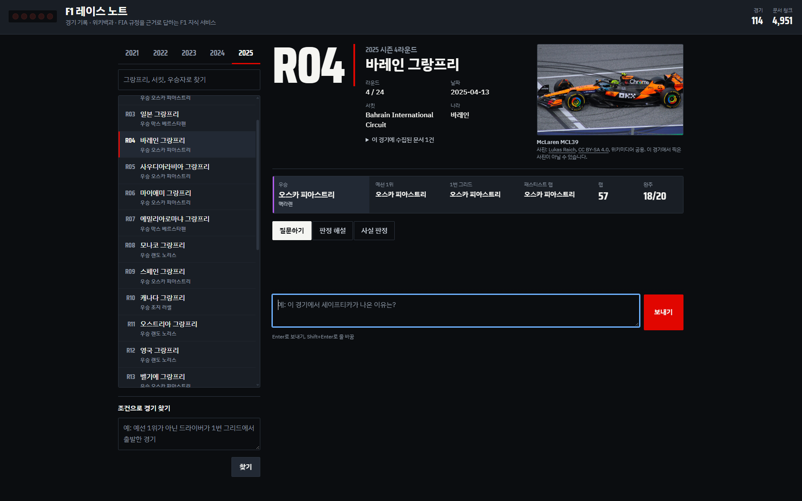

### 4.2 수집과 청킹 (F2003~F2005)

```text
프롬프트 1이 뽑은 검색어   Lewis Hamilton, Track limits, Michael Masi, 2021 Formula One World Championship
선별 결과                  색인 1건(Lewis Hamilton), 제외 9건(List of career achievements by Lewis Hamilton,
                           Lewis Hamilton (disambiguation), Anthony Hamilton, Nicolas Hamilton,
                           Glossary of motorsport terms, 2023 Austrian/United States/Qatar Grand Prix,
                           Rail speed limits in the United States)
같은 질문 재질문           첫 수집 15.9초 → 재질문 0.0초, 새로 색인 0건
경기 자체 문서             2021 Abu Dhabi Grand Prix 색인됨
청크 크기·중복 변경        500/100자 → 3개, 1000/200자 → 2개, 2000/300자 → 2개
```

처음 묻는 질문은 화면에 수집 단계가 실시간으로 보인다(왼쪽: 검색어 추출 직후, 오른쪽: 후보 검색 → 선별 → 본문 수집 → 색인 → 검색 → 생성).

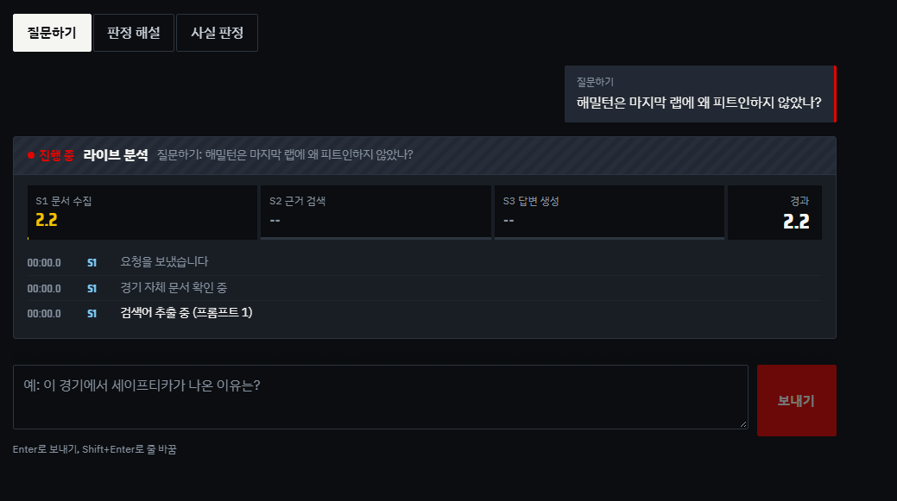 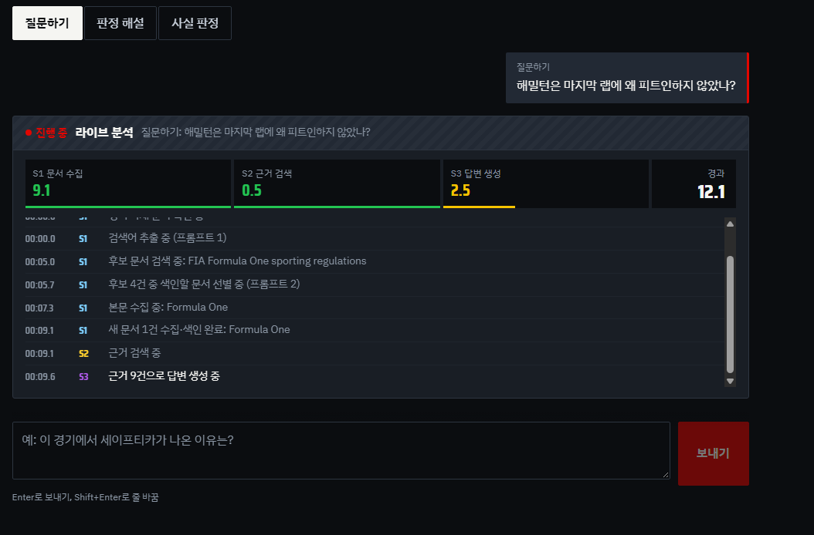

같은 질문을 다시 물으면 수집을 건너뛴다(12.83초, 새로 수집: Formula One → 4.89초, 이미 수집한 검색어 4개 재사용).

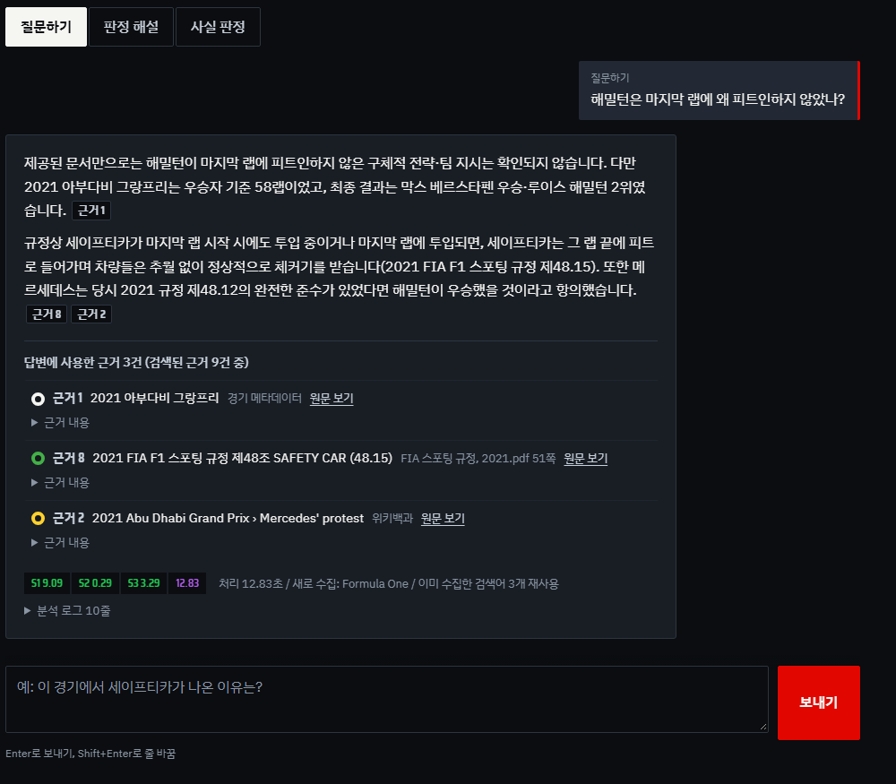 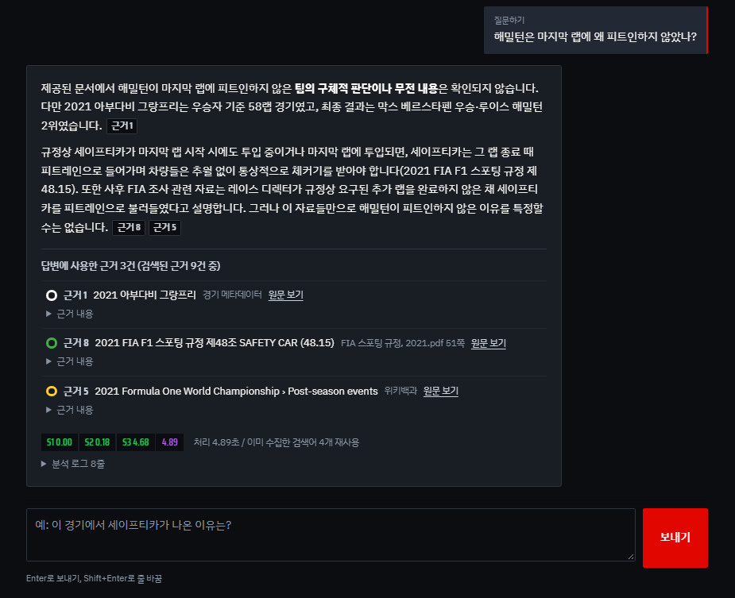

### 4.3 답변과 근거 (F2006~F2008)

```text
Top-k를 바꾸면 근거 목록이 달라짐   k=3 → 근거 6개, k=6 → 9개, k=10 → 13개
LangGraph 노드                     retrieve → generate
답변의 근거 번호 = 화면 근거 목록   본문 [1, 8, 9], 표시 [1, 8, 9]
근거 출처 종류 구분                 경기 메타데이터, 위키백과, FIA 스포팅 규정
문서에 없는 질문                    "관중석 입장권의 평균 가격은 제공된 문서에서 확인되지 않습니다."
```

답변 본문의 근거 번호와 아래 근거 목록이 같고, 출처 종류를 타이어 색(흰색=경기 메타데이터, 노랑=위키백과, 초록=FIA 규정)으로 구분한다. 근거 번호를 누르면 원문이 열린다.

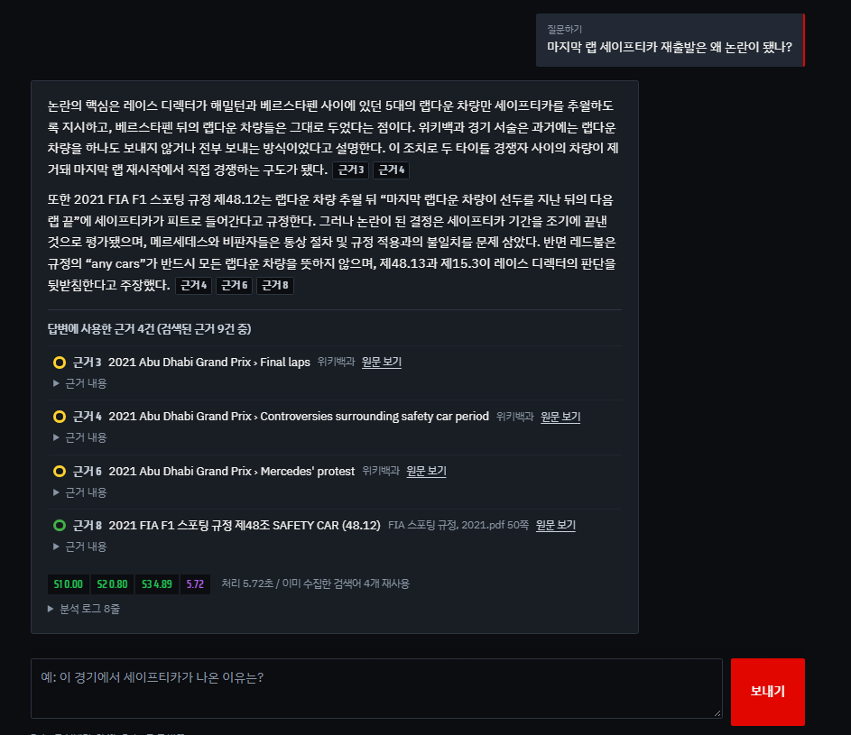

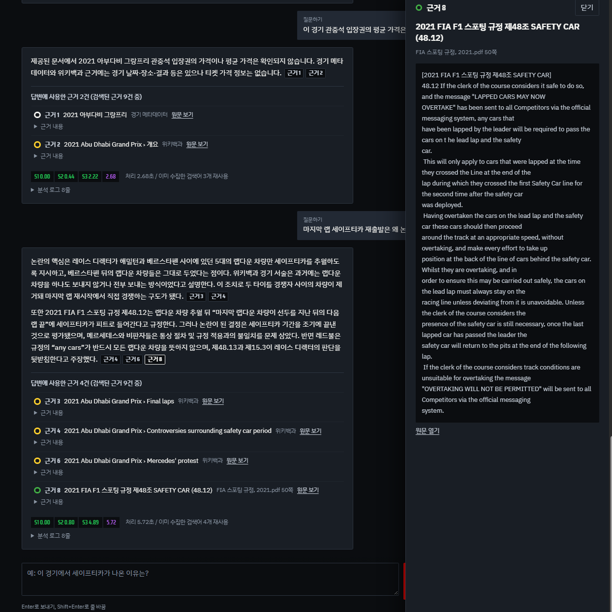

문서에 없는 것을 물으면 추측하지 않고 확인되지 않는다고 답한다.

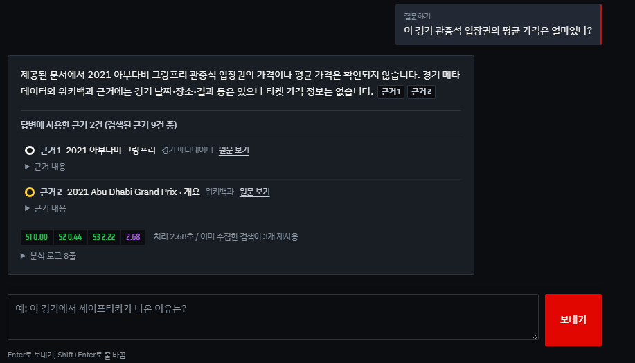

인용 근거가 없을 때의 안내는 실제 실행에서 인용 없는 답변이 나오지 않아 화면으로 재현하지 못했고, 자동 테스트 `test_no_citation_shows_notice`로 확인했다.

### 4.4 서비스 기능과 화면 (F2009~F2012)

경기를 바꾸면 이전 대화가 섞이지 않는다(왼쪽: 2021 아부다비 대화, 오른쪽: 2023 사우디로 바꾼 직후).

 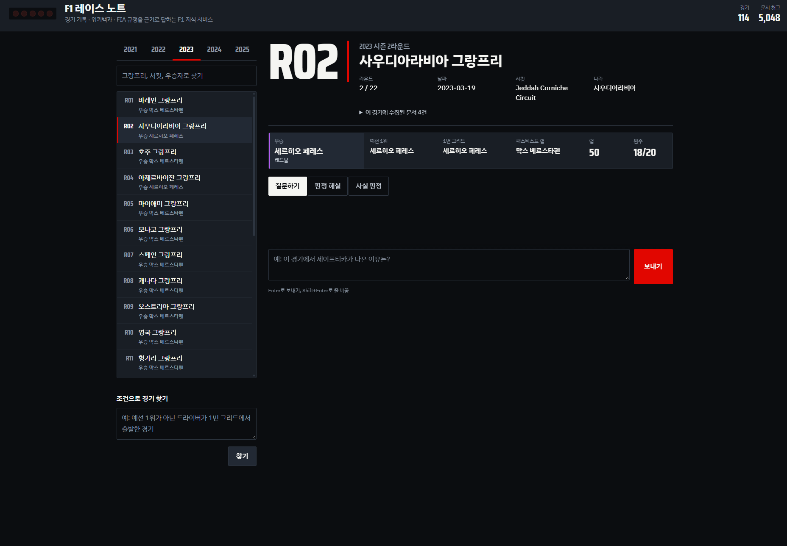

도메인 특화 기능: 판정 해설(그 시즌 규정 조항과 공식 판정 아님 안내)과 사실 판정.

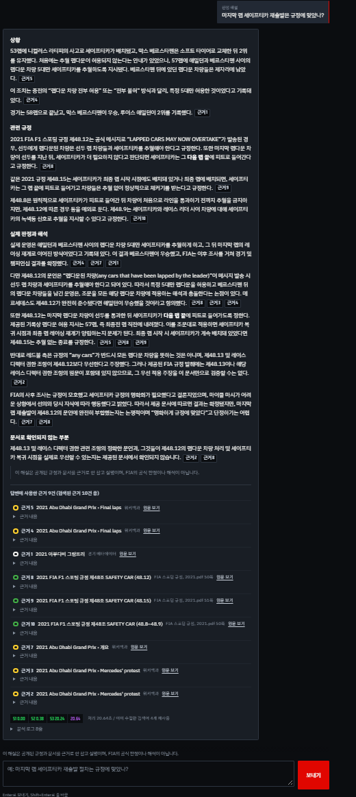 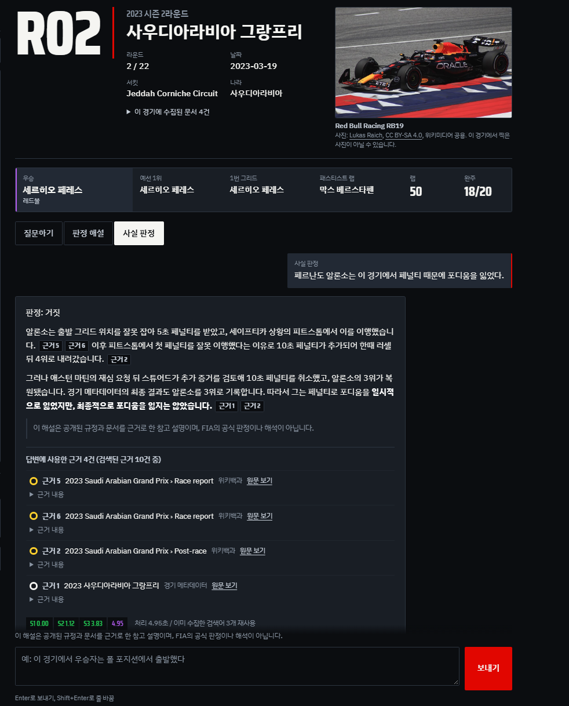

조건 기반 탐색: "예선 1위가 아닌 드라이버가 1번 그리드에서 출발한 경기" → 9건. 사람이 경기 기록과 대조해 모두 조건에 맞는 것을 확인했다(2021 영국·이탈리아·튀르키예·상파울루, 2022 벨기에·상파울루, 2023 벨기에, 2024 벨기에·카타르).

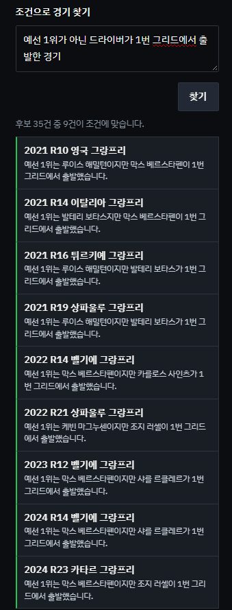

색인 없음, API 키 없음 안내. 화면에는 할 일만 보이고 키·경로·오류 추적 정보는 보이지 않는다(NF2004).

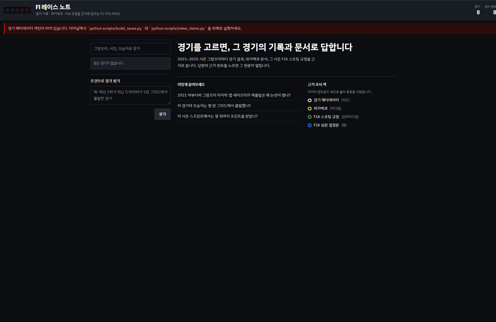

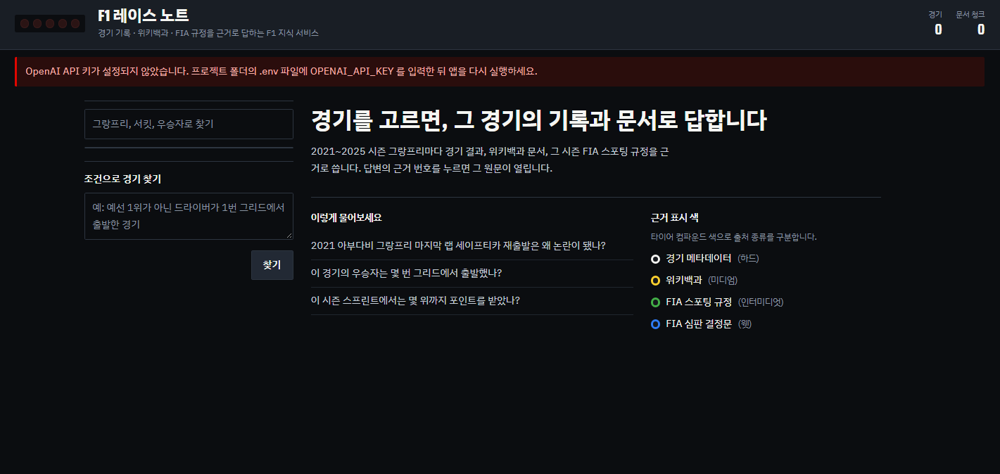

위험 도메인 면책 안내: F1은 위험 도메인이 아니어서 해당 없음. 판정 해설·사실 판정에는 "FIA의 공식 판정이나 해석이 아닙니다" 안내를 붙인다.

### 4.5 심화 기능 (F2013~F2016)

- F2013: 위 화면 전체가 HTML·CSS·JavaScript 화면이다. 원문 패널 확대: `screenshots/11_html_drawer.png`
- F2014: 6절 비교표
- F2015: 6절 비교표와 `04_RAG_전후_비교.md`
- F2016: 03·05번 화면의 근거 목록에 위키백과와 FIA 스포팅 규정(파일명·쪽 표시)이 함께, 출처 종류별 색으로 구분되어 나온다

### 4.6 RAG 사용 전후 품질 비교

4절 "RAG 전후 비교" 표와 `docs/04_RAG_전후_비교.md`(질문 10개의 두 답변 원문, 채점, 사용한 근거)를 본다.

### 4.7 비기능 요구사항

1절 대조표의 NF2001~NF2007 행과 4절 "처리 시간"을 본다.

## 6. 심화 기능: 필수 구현과의 결과 비교

| 심화 | 필수 구현(비교 기준) | 심화 적용 결과 | 근거 |
| --- | --- | --- | --- |
| F2013 프론트엔드 직접 구현 | Streamlit 화면: 진행 상태를 단계 메시지로, 근거는 펼치기 목록으로 표시 | 같은 기능 + 진행 이벤트를 S1·S2·S3 섹터와 시각이 찍힌 로그로 표시, 근거 번호를 누르면 원문 패널, 답변 아래 단계별 시간과 분석 로그. 화면과 서버를 분리하고 요청·응답 형식을 `api/schemas.py`에 정의 | 5절 화면, `test_ask_streams_progress_then_result` |
| F2014 MMR 검색 | 유사도 검색: 아부다비 질문에서 서로 다른 문서 2, 근거 간 평균 유사도 0.629, "Final laps"·"Mercedes' protest" 섹션이 2청크씩 | MMR(λ0.5): 서로 다른 문서 3, 평균 유사도 0.520, 근거 4개가 바뀌고 같은 섹션 중복이 사라짐. 관련 섹션이 빠지는 대가가 있어 기본값을 λ0.7로 조정 | 4절, `docs/results/retrieval_comparison.md` |
| F2015 RAG 전후 비교 | RAG 없이(모델 지식만): 정확 7/8(첫 실행 6/8), 근거 제시 0/10, 문서에 없는 질문 2개 모두 지어냄("Let's go!", 입장권 "약 2,400 AED") | RAG: 정확 8/8(두 실행 모두), 근거 제시 10/10, 문서에 없는 질문 2/2 확인되지 않는다고 답함 | 4절, `docs/04_RAG_전후_비교.md` |
| F2016 여러 문서 출처 결합 | 위키백과만: 판정 해설에서 규정 조항의 실제 문구를 인용할 수 없음 | 위키백과 + FIA 스포팅 규정 PDF: 2021 아부다비 판정 해설 근거 9건 중 3건이 규정(48.12 "LAPPED CARS MAY NOW OVERTAKE"·48.15·48.8–48.9)이고 파일명·쪽까지 표시. 규정은 조항 단위, 위키는 섹션+길이 기준으로 다르게 청킹 | `05_ruling.png`, 설계문서 4절 |

## 7. 화면 캡처 파일 목록

모두 HTML 화면(`uvicorn f1rag.api.server:app` → `http://localhost:8000`, F2013)에서 실제 키와 데이터로 찍었다. 같은 기능은 Streamlit 화면(`streamlit run app.py`)에도 있다. 파일은 `docs/screenshots/`.

| 파일 | 내용 | 확인 항목 |
| --- | --- | --- |
| 00_intro.png | 첫 진입 연출: 스타트 라이트 다섯 칸 | 화면 디자인 (증명용 아님) |
| 01_index_count.png | 오른쪽 위 색인 현황(경기 114, 문서 청크 4,951), 2025 바레인 선택 화면: 우승 차 사진(출처 표시)과 기록 스트립 | F2001, F2002 |
| 02_progress_start.png, 02_progress.png | 처음 묻는 질문의 라이브 분석: S1 수집 → S2 검색 → S3 생성 섹터와 시각이 찍힌 진행 로그 | F2012 |
| 03_answer_evidence.png | "마지막 랩 세이프티카 재출발은 왜 논란이 됐나?" 답변과 근거 목록(위키백과·FIA 규정을 타이어 색으로 구분), 본문 근거 번호 = 목록 번호 | F2007, F2008, F2016 |
| 04_switch_race_a.png, 04_switch_race_b.png | 2021 아부다비 대화 → 2023 사우디로 바꾸면 대화가 비어 있음 | F2009 |
| 05_ruling.png | 판정 해설: 상황·관련 규정·실제 판정과 해석·문서로 확인되지 않는 부분, 공식 판정 아님 안내, 규정 근거(48.12, 48.15, 48.8–48.9) | F2010, F2016 |
| 06_factcheck.png | 사실 판정 "판정: 거짓"과 근거 | F2010 |
| 07_explore.png | 조건 탐색 "예선 1위가 아닌 드라이버가 1번 그리드에서 출발한 경기" 결과 9건(모두 조건에 맞음) | F2011 |
| 08_no_index.png | 색인 0건 안내와 실행할 스크립트 | F2012, NF2004 |
| 09_no_key.png | API 키 없음 안내 | F2012, NF2003, NF2004 |
| 10_not_found.png | 문서에 없는 질문(입장권 평균 가격)에 확인되지 않는다고 답함 | F2007 |
| 11_html_ui.png, 11_html_drawer.png | HTML 화면 질문·답변·근거, 근거 번호를 누르면 열리는 원문 패널 | F2013 |
| 12_cache_first.png, 12_cache_reuse.png | 같은 질문: 처음 12.83초(새로 수집: Formula One) → 다시 물으면 4.89초, "이미 수집한 검색어 4개 재사용" | NF2002, NF2001 |

## 8. 상호 체크리스트 (옆 교육생 점검)

| 확인 항목 | 점검자 결과 (통과/실패/미확인) | 의견 |
| --- | --- | --- |
| README만 보고 설치·색인·실행까지 할 수 있다 | | |
| 경기를 고르고 질문하면 근거와 함께 답한다 | | |
| 근거 번호를 눌러(HTML) 또는 펼쳐(Streamlit) 원문 위치를 확인할 수 있다 | | |
| 문서에 없는 질문에 지어내지 않고 확인되지 않는다고 답한다 | | |
| 경기를 바꾸면 이전 대화가 섞이지 않는다 | | |
| 판정 해설에 그 시즌 규정 조항이 근거로 나온다 | | |
| 조건 탐색 결과가 조건과 맞는다 | | |
| 화면에 API 키·프롬프트·오류 추적 정보가 보이지 않는다 | | |
| 점검자 / 날짜 | | |

## 9. 제출 전 점검 목록 (4.8)

| 점검 항목 | 결과 | 확인 근거 |
| --- | --- | --- |
| 필수 F2001~F2012가 모두 동작한다 | 통과 | `verify.py` 결과(1·3절), 5절 화면 |
| 선택한 심화 기능이 동작하고 필수 구현의 결과와 비교되어 있다 | 통과 | 6절 비교표 |
| 증명을 위한 스크린샷 항목을 모두 첨부했다 | 통과 | 5절, `docs/screenshots/` 17장 |
| 요구사항 정의서·RAG 파이프라인 설계문서·소스코드·README.md를 모두 포함했다 | 통과 | `docs/01`, `docs/02`, `f1rag/`·`scripts/`·`web/`, `README.md` |
| 검증 결과(요구사항 대조표, 테스트 결과표, 셀프·상호 체크리스트)를 포함했다 | 상호 체크리스트 작성 후 통과 | 1·2·3·8절 |
| 제출 zip에 `.env`·`.venv`·`data/chroma/`·FIA PDF가 없다 | 압축 시 확인 | `python scripts/make_submission.py --name ...` 출력의 "확인: … 없음" |
| 파일 이름: `AI코어프로젝트2_[주제명]_지역_반_성명.zip` | 압축 시 확인 | 위 명령의 `--name` |
