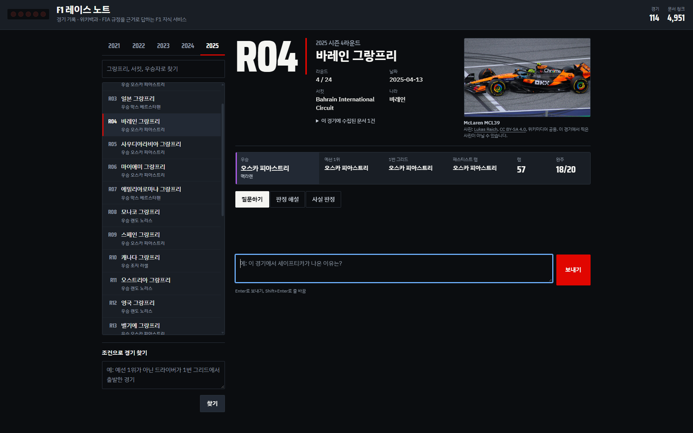

# F1 레이스 노트

2021~2025 시즌 F1 그랑프리 경기를 고르고 질문하면, **경기 기록 · 위키백과 · 그 시즌 FIA 스포팅 규정**을 근거로 답하고 근거 원문을 함께 보여 주는 RAG 지식 서비스입니다. SSAFY AI 코어 프로젝트 2회차 과제로, 필수 기능 F2001~F2012와 심화 기능 F2013~F2016을 모두 구현했습니다.

- 질문하기: 경기에 관한 질문에 근거 번호를 붙여 답합니다.
- 판정 해설: 경기 중 사건을 그 시즌 규정 조항과 함께 해설합니다.
- 사실 판정: F1에 관한 주장을 사실, 거짓, 일부 사실, 확인 불가 중 하나로 판정합니다.
- 조건으로 경기 찾기: "1번 그리드에서 출발했지만 우승하지 못한 시즌 최종전"처럼 조건을 입력하면 맞는 경기를 찾습니다.



## 실행 방법

Python 3.10 이상이 필요합니다.

```bash
# 1. 설치
python -m venv .venv
source .venv/bin/activate            # Windows: .venv\Scripts\activate
pip install -r requirements.txt

# 2. 키 설정: .env.example 을 .env 로 복사한 뒤 OPENAI_API_KEY(또는 GMS_KEY), WIKI_CONTACT(이메일)를 입력
cp .env.example .env                 # Windows: copy .env.example .env
python scripts/check_llm.py          # 키·주소·모델 연결 점검 (색인 전에 한 번)

# 3. 데이터 준비와 색인 (처음 한 번)
python scripts/build_races.py        # Jolpica → data/processed/races.json, 위키 문서 커버리지 표
python scripts/index_items.py        # 경기 메타데이터 색인 (RAG 1)
python scripts/download_pdfs.py      # FIA 스포팅 규정 PDF 내려받기
python scripts/index_pdfs.py         # 규정 PDF 조항 단위 색인 (F2016)
python scripts/collect_item_docs.py  # (선택) 경기별 위키 문서 미리 수집. 첫 질문이 빨라짐

# 4-a. Streamlit 화면
streamlit run app.py                 # http://localhost:8501

# 4-b. HTML/CSS/JS 화면 (F2013)
uvicorn f1rag.api.server:app --port 8000   # http://localhost:8000, API 문서 /api/docs
```

기본 설정은 SSAFY GMS 모델을 Responses API(`/v1/responses`)로 호출합니다. 답변 생성과 평가 채점은 `gpt-5.6-terra`, 검색어 추출·후보 선별·조건 탐색은 초경량 `gpt-6-luna`를 씁니다. `.env.example`에 GMS 주소가 들어 있습니다. OpenAI를 직접 쓰면 `OPENAI_BASE_URL` 줄을 비우고 `config/settings.yaml`의 `models`에서 모델 이름을 바꿉니다. GPT-5 계열은 `temperature`를 받지 않아 `null`로 두었고, 응답 시간을 줄이려고 `reasoning_effort: low`를 씁니다. 짧은 JSON만 내는 단계에 플래그십 모델을 쓰면 비용과 시간만 늘어서 모델을 둘로 나눴습니다. 답변 품질을 더 높이려면 `chat`을 `gpt-5.6-sol`로 바꿉니다.

외부 호출이 막힌 환경이라면, 온라인 환경에서 `python scripts/collect_item_docs.py --export-offline`로 문서 묶음을 만든 뒤 `settings.yaml`에서 `collection.offline: true`로 바꿔 실행합니다.

### 검증과 평가

```bash
python -m pip install -r requirements-dev.txt
python -m pytest -v                  # 자동 테스트 53개 (가짜 모델, 키 없이 실행)
python scripts/verify.py             # 명세서 4장 확인 → docs/results/verification_report.md
python scripts/compare_retrieval.py  # 유사도 vs MMR, Top-k 비교 → docs/results/retrieval_comparison.md
python scripts/evaluate_rag.py       # RAG 전후 비교 → docs/04_RAG_전후_비교.md
```

API 키 없이 화면만 확인하려면 `F1RAG_FAKE_MODELS=1`로 실행합니다. 이때 답변은 형식만 맞춘 예시이고, 화면 상단에 가짜 모델 모드라고 표시됩니다. 색인과 캐시도 실제 모드와 다른 폴더(`data/chroma_fake`, `data/cache_fake`)를 씁니다.

## 기능

| 번호 | 기능 | 구분 |
| --- | --- | --- |
| F2001~F2002 | 2021~2025 시즌 경기(약 114건) 메타데이터를 경기당 텍스트 1개로 만들어 `f1_races` 컬렉션에 색인 | 필수 |
| F2003~F2005 | 프롬프트 1로 검색어 추출 → 위키백과 후보 수집 → 프롬프트 2로 선별 → 섹션·길이 기준 청킹 후 `f1_docs` 색인. 경기 자체 문서는 항상 색인 | 필수 |
| F2006~F2008 | 경기 메타데이터는 항상 근거 1번, 그 경기 문서와 그 시즌 규정을 따로 검색해 병합·중복 제거 → LangGraph retrieve/generate → 실제 인용된 근거만 표시 | 필수 |
| F2009 | 시즌·경기 선택, 경기별 대화 기록 | 필수 |
| F2010 | 판정 해설, 사실 판정 | 필수 |
| F2011 | 자연어 조건으로 경기 찾기 | 필수 |
| F2012 | 단계별 진행 상태, 색인 없음·키 없음·근거 없음 안내, 판정 기능의 "공식 판정 아님" 안내 | 필수 |
| F2013 | FastAPI 서버 + HTML/CSS/JS 화면: 진행 상태를 S1 수집·S2 검색·S3 생성 섹터와 로그로 표시, 근거 번호를 누르면 원문 패널, 우승 차 사진과 기록 스트립 | 심화 |
| F2014 | MMR 검색 (후보 30건 중 6건, λ=0.7) | 심화 |
| F2015 | 대표 질문 10개로 RAG 전후 정확성·근거 제시·모름 응답 비교 | 심화 |
| F2016 | 위키백과 + FIA 규정 PDF + 심판 결정문 결합, 출처 종류별 청킹과 표시 | 심화 |

## 데이터 준비와 색인 절차

1. `build_races.py`가 Jolpica-F1 API에서 시즌별 일정과 결선 결과를 받아 경기마다 우승·포디움·1번 그리드·리타이어 수를 정리합니다. 경기마다 위키백과 '경기 자체 문서'를 정합니다. 기본 설정은 영어 원문만 씁니다(아래 '영어 원문을 쓰는 이유').
2. `index_items.py`가 경기 1건을 검색 텍스트 하나로 만들어 경기 ID를 청크 ID로 색인합니다. 다시 실행해도 덮어쓰기만 일어납니다.
3. `index_pdfs.py`가 FIA 스포팅 규정을 조항(`55) SAFETY CAR`) 단위로 자르고, 쪽마다 반복되는 머리말·꼬리말을 지운 뒤 시즌 정보와 함께 색인합니다.
4. 질문할 때 위키 문서를 수집합니다. 같은 경기에서 이미 수집한 검색어는 다시 수집하지 않습니다.

## 영어 원문을 쓰는 이유

질문과 답변은 한국어지만, 근거 문서는 영어 원문(영어 위키백과, FIA 규정)만 씁니다. 질문하면 프롬프트 1이 영어 검색 문장을 함께 만들고, 그 문장으로 영어 원문을 검색한 뒤 한국어로 답합니다.

- 한국어 경기 문서는 결과표만 있거나 영어판을 줄여 옮긴 경우가 많아, 세이프티카·페널티 같은 경기 중 사건이 빠져 있습니다.
- 두 언어 문서를 섞으면 같은 사람이 "베르스타펜"과 "페르스타펀"으로 섞여 나오고, 같은 사건의 서술이 엇갈립니다.
- 한국어 질문으로 영어 문서를 그대로 검색하면 점수가 낮게 나와, 관련 문단이 근거에서 밀립니다.

명세서는 한국어 위키백과를 권장하므로, `config/settings.yaml`의 `collection.languages`를 `[ko, en]`으로 바꾸면 한국어 문서도 함께 씁니다.

## 데이터·문서 출처와 이용 조건

| 데이터 | 출처 | 이용 조건 |
| --- | --- | --- |
| 경기 메타데이터 | [Jolpica-F1 API](https://github.com/jolpica/jolpica-f1) | 비상업적 이용, CC BY-NC-SA 4.0, 초당 4회·시간당 500회 |
| 경기·개념 문서 | 영어 위키백과 (설정으로 한국어 추가 가능) | CC BY-SA 4.0, 연락처가 들어간 User-Agent 필요 |
| 스포팅 규정, 심판 결정문 | [FIA](https://www.fia.com/regulation/category/110) | 재배포 허락을 확인하지 못해 PDF는 저장소에 넣지 않고 링크와 내려받기 스크립트만 둠 |

자세한 내용은 [docs/05_데이터_출처와_이용조건.md](docs/05_데이터_출처와_이용조건.md)에 있습니다. 이 서비스는 FIA·Formula 1과 관련이 없는 교육용 프로젝트입니다.

## 심화 기능 적용 요약

- **F2013**: 화면(`web/`)과 서버(`f1rag/api/`)를 분리했습니다. 요청·응답 형식은 `f1rag/api/schemas.py`에 정의했고, `/api/ask`는 진행 상태를 한 줄씩 보내는 NDJSON 스트림입니다. 근거 종류는 F1 타이어 컴파운드 색으로 구분하고, 답변 진행은 랩의 세 섹터(S1 문서 수집, S2 근거 검색, S3 답변 생성)로 보여 줍니다. 근거 번호를 누르면 원문 패널이 열립니다. 경기를 고르면 우승 팀의 그 시즌 차 사진(위키미디어 공용 자유 라이선스, 출처 표시)이 함께 나옵니다. 사진을 미리 받아 확인하려면 `python scripts/check_car_images.py`. 첫 진입 연출을 캡처하려면 `http://localhost:8000/?intro=hold`(라이트 다섯 칸이 켜진 채 멈춤) 또는 `?intro=title`(꺼진 뒤 서비스 이름에서 멈춤)으로 열고, 화면을 누르면 넘어갑니다.
- **F2014**: `settings.yaml`의 `retrieval.search_type: mmr`이 기본값입니다. `compare_retrieval.py`가 같은 질문의 유사도 검색과 MMR 결과를 비교합니다. 비교 지표는 서로 다른 문서 수, 근거 간 평균 유사도, 출처 종류 분포입니다.
- **F2015**: `eval/questions.yaml`에 질문 10개와 참고 답안이 있습니다. 문서에 없는 내용을 묻는 질문 2개가 포함됩니다.
- **F2016**: 위키는 섹션 경계를 지키며 1,000자/200자로 자르고, 규정은 조항 단위로 자릅니다. 길이로 자르면 조항이 중간에 끊겨 다른 조항 번호로 인용되기 때문입니다.

## 폴더 구조

```text
app.py                     Streamlit 진입점
config/settings.yaml       청크 크기, Top-k, 검색 방식 등 실행 설정
f1rag/
  domain/                  데이터 준비 영역: F1에 묶인 코드와 문구 (NF2005)
    races.py               Jolpica → 경기 메타데이터, 색인 텍스트
    regulations.py         FIA 규정·결정문 PDF 파싱과 청킹
    names.py               한국어 표기
    profile.py             역할 문구, 출처 이름, 기능별 답변 형식, 검색 범위 규칙
  sources/                 외부 문서 출처: HTTP 예절, 위키백과, 오프라인 묶음, PDF
  store/                   Vector Store 영역: 컬렉션, 위키 청킹, 청크 ID
  rag/                     RAG 파이프라인 영역: 프롬프트, 수집기, 캐시, 검색·병합, LangGraph, 근거 번호
  services/                서비스 기능 영역: 질의응답·판정, 조건 탐색
  ui/                      Streamlit 화면
  api/                     FastAPI 서버와 요청·응답 형식 (F2013)
  devtools/                가짜 모델, 키 검사
web/                       HTML/CSS/JS 화면 (F2013)
scripts/                   수집·색인·검증·평가 스크립트
eval/questions.yaml        RAG 전후 비교 질문
tests/                     자동 테스트 (가짜 모델)
docs/                      요구사항 정의서, 설계문서, 검증 결과, 비교 결과, 출처
```

## 제출 문서

- [요구사항 정의서](docs/01_요구사항_정의서.md)
- [RAG 파이프라인 설계문서](docs/02_RAG_파이프라인_설계문서.md)
- [검증 결과](docs/03_검증_결과.md)
- [RAG 전후 비교](docs/04_RAG_전후_비교.md)
- [데이터 출처와 이용 조건](docs/05_데이터_출처와_이용조건.md)

## 제출용 압축

탐색기에서 폴더를 그대로 압축하면 `.env`(API 키), `.venv`, `data/chroma`까지 들어간다. 아래 스크립트는 `.gitignore`와 같은 기준으로 빼고 상위 폴더에 zip을 만든다.

```
python scripts/make_submission.py --name AI코어프로젝트2_F1레이스노트_지역_반_성명
```
